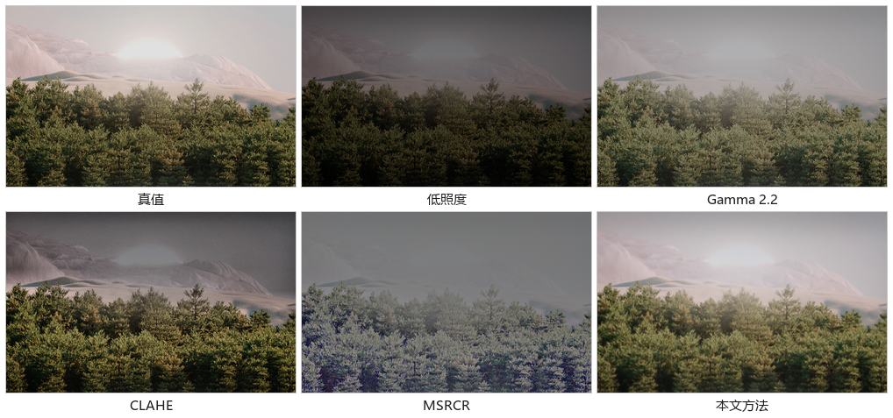

# 低照度图像增强：引导滤波光照估计 + 自适应光照映射

东北大学 2026 年《图像处理》课程大作业（学号 20245630，张子腾）。

仓库地址：<https://github.com/zaki0415/lowlight-enhance>　课程报告：[报告-张子腾-20245630.docx](报告-张子腾-20245630.docx)

纯 `numpy` + `Pillow` 实现，**不依赖 OpenCV、scipy 或深度学习框架**，所有滤波算子（盒式滤波、
引导滤波、高斯模糊、SSIM、CLAHE）都是自己写的。960×600 的图单张约 0.5 s（笔记本 CPU，纯 float64 单线程）。

本文在 MSRCR 的 Retinex 框架上改了四处：光照图改用引导滤波估计、光照按归一化幂律重新配光、
反射层按放大倍数做噪声感知的收缩、色度保持的软限幅收尾。第 5 节的表格和消融实验给出了每处改动的收益。



左起：真值、低照度输入、Gamma 2.2、CLAHE、MSRCR、本文方法。

## 环境

```
Python >= 3.9
numpy
Pillow
```

```bash
pip install -r requirements.txt
```

## 运行

```bash
# 1) 单张图
python scripts/demo.py data/low/02.png -o results/demo.png

# 2) 全部实验（约 3 分钟）：四个方法 + 消融 + 耗时
python -m scripts.run_benchmark --ablation --timing --scaling

# 3) 出图
python -m scripts.make_figures
```

结果写到 `results/`：`metrics.csv`（逐图逐方法）、`summary.csv`（汇总）、
`ablation.csv`、`psweep.csv`、`scaling.csv`，图在 `results/figs/`。

如果想换素材或改噪声参数重新生成测试集：

```bash
python -m scripts.make_dataset --src "C:/Windows/Web"
```

## 方法

记输入为 $I$（sRGB，$[0,1]$），Retinex 假设 $I = L \circ R$，$L$ 是光照，$R$ 是反射（本征颜色）。

1. **M1 光照估计**：$V=\max_c I_c$，用引导滤波 $L=\mathrm{GF}(V,V;r,\varepsilon)$，
   $r=32$、$\varepsilon=3\times10^{-3}$。窗口内方差远大于 $\varepsilon$ 时（有边缘）输出跟住引导图，
   否则退化为均值滤波。代价 O(N)，与半径无关。
2. **M2 重新配光**：$L'=(L/\bar L)^{p}$，$p=0.6$，再整体乘一个系数把平均亮度对到 0.50。
   归一化让暗图和亮图都落到同一目标亮度；$p<1$ 压缩明暗差，$p=1$ 退化成只调曝光。
3. **M3 反射层**：$R=I/L$，放大倍数 $k=L'/L$ 在暗处很大，是噪声被放大的根源。
   令 $\alpha=\min((k-1)/3,\,0.85)$，把 $R$ 按 $\alpha$ 向 $3\times3$ 局部均值收缩；
   细节增益 $\beta=0.70+0.30\exp(-((k-1)/1.8)^2)$，亮部保留细节，暗部平滑。
4. **M4 收尾**：同一个增益图作用于三通道（色度比例不变），高光用 $1-e^{-x}$ 软压缩，避免成片死白。

## 结果

8 张 960×600 配对测试图（真值 + 合成的低照度图）上的平均值：

| 方法 | PSNR/dB | SSIM | ΔE*ab | 阴影噪声 | 耗时/s |
|---|---|---|---|---|---|
| Gamma 2.2 | 22.44 | 0.914 | 12.47 | 0.0151 | 0.04 |
| CLAHE | 12.74 | 0.704 | 23.53 | 0.0205 | 0.09 |
| MSRCR | 12.44 | 0.614 | 32.38 | 0.0484 | 0.55 |
| **本文方法** | **25.85** | **0.962** | **6.03** | **0.0069** | 0.52 |
| （解析反解） | 34.98 | 0.888 | 3.96 | — | — |

「解析反解」是假定已知曝光、光照场与白平衡时的直接相除结果，只用来标出噪声决定的上限。

消融（去掉单个模块后的 PSNR/dB）：

| 版本 | PSNR | SSIM | ΔE |
|---|---|---|---|
| 完整 | 25.85 | 0.962 | 6.03 |
| 去 M1（高斯光照） | 25.73 | 0.941 | 6.11 |
| 去 M2（固定 γ=1.8） | 17.96 | 0.910 | 13.03 |
| 去 M3（不收缩） | 25.19 | 0.856 | 8.34 |
| 去 M4（逐通道拉伸） | 18.08 | 0.927 | 13.67 |

## 数据

`data/gt` 是 8 张 960×600 的真值图（4K 素材中心裁剪，线性域统一曝光到平均亮度 0.50），
`data/low` 是对应的低照度图，按简化的相机成像模型合成：

```
线性光 × 曝光(≈0.2) × 空间不均光照场 × 暗角 → + 散粒噪声 + 读出噪声 → × 白平衡偏移 → sRGB
```

光照场由两团低频光斑加一块软边矩形组成（模拟路灯、窗光）。`data/meta.csv` 记录了每张图的
曝光系数、色偏、平均亮度，`src/dataset.py` 里的 `synthesize_low_light` 可以完全复现。

用半合成数据是因为手头没有配对的真实低照度图，只有这样才有真值算 PSNR/SSIM。
这是本实验最大的局限：真实噪声模型（泊松-高斯混合、坏点、降噪涂抹）比这里复杂得多。

## 目录

```
src/
  filters.py    盒式滤波（积分图）、引导滤波、高斯模糊、双线性缩放
  color.py      sRGB 线性化、亮度、饱和度、软限幅
  enhance.py    本文方法（各模块可用开关关掉）
  baselines.py  Gamma、CLAHE、MSRCR
  metrics.py    PSNR、SSIM、ΔE、熵、平均梯度、色彩丰富度、阴影噪声
  dataset.py    低照度图合成、曝光归一化、解析反解
  viz.py        拼图与图表（Pillow 画的，没用 matplotlib）
scripts/
  make_dataset.py   生成 data/gt 与 data/low
  run_benchmark.py  主实验与消融
  make_figures.py   出报告用的图
  demo.py           单张图演示
docs/
  build_report.py   生成课程报告的脚本（从 results/*.csv 取数）
报告-张子腾-20245630.docx   课程报告
```

## 参考

- Land, McCann. *Lightness and Retinex Theory*. JOSA, 1971.
- Jobson, Rahman, Woodell. *A Multiscale Retinex for Bridging the Gap Between Color Images and the Human Observation of Scenes*. IEEE TIP, 1997.
- He, Sun, Tang. *Guided Image Filtering*. ECCV 2010 / TPAMI 2013.
- Guo, Li, Ling. *LIME: Low-Light Image Enhancement via Illumination Map Estimation*. IEEE TIP, 2017.
- Wang, Bovik, Sheikh, Simoncelli. *Image Quality Assessment: From Error Visibility to Structural Similarity*. IEEE TIP, 2004.
